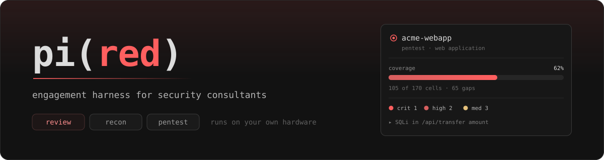
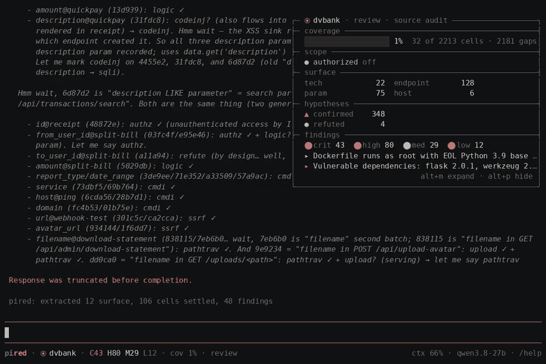

<div align="center">



**A security assessment harness for consultants — whitebox review and blackbox testing in one workspace, with coverage tracking that won't let an engagement end early.**

*Runs on your own hardware, so client code never leaves the box. An AI agent, not a toolbox: it ships no scanners; it drives the ones you already have.*

`review` · `recon` · `pentest` — as a [pi](https://pi.dev) extension

</div>

---

## Why pired

A consultant under NDA often *cannot* paste client source into a frontier API — that is a contract term, not a preference. And an engagement is rarely just one half: the same scope buys a code review *and* a test, delivered as one report. pired is built for that shape of work — a thin, durable **security layer** on top of the [pi coding agent](https://pi.dev) (an engagement workspace, a scope gate, a security-operator prompt, and two tools, `record`/`recall`) driving the environment's own tools (`nmap`, `ffuf`, `curl`, `sqlmap`, `semgrep`, …) through `bash`.

Three claims:

- **It runs on your hardware.** Tuned for ~30B open-weight models (Qwen3.8 27B, Gemma 3 27B, DeepSeek), so client code never leaves the engagement box — and it still beats a frontier agent on recall and critical coverage (below). Frontier and subscription models work too, where the engagement allows them.
- **Coverage discipline, not vibes.** `checklist × inventory = coverage → hypotheses → findings`, with `recall gaps` keeping the agent testing while gaps remain — and *ruling a class out* recorded as real work, which a findings list cannot express. What the benchmark shows is the security prompt lifting a 27B model past a frontier agent on recall; whether the ledger compounds on top of that is stated as open, below.
- **One workspace, both halves of the engagement.** `review` for whitebox, `recon`/`pentest` for blackbox, over a single engagement ontology, so findings, evidence, and coverage correlate across the whole job instead of living in two disconnected tools.

**What pired is not.** Not a scanner: it owns no detection engines and makes no claim to reproducible, rule-count-comparable output. Not the assessment: it drafts findings for an operator to verify, and the operator signs the report. Two principles keep it that way:

- **An AI agent, not a toolbox.** No bundled scanners. Heavy tooling is opt-in; missing tools are *requested*, not carried.
- **Built to last.** A harness-agnostic **ports & adapters** core with *zero* host imports, so the security engine outlives any single agent frontend.

---

## The benchmark result

A **ground-truth-labeled vulnerable banking app** (53 CWE/OWASP-tagged vulnerabilities, deterministic grader). Same target, same prompt, same grader — the only variable is **harness + model**.

| | Recall | Precision | F1 | Critical recall | Cost/scan |
|---|:--:|:--:|:--:|:--:|:--:|
| **pired + Qwen3.8 27B** *(local)* | **0.74** <sub>[0.70, 0.79]</sub> | 0.65 | 0.69 | **100%** | ~$0.26 |
| codex + gpt-5.6-sol *(frontier)* | 0.68 | **0.80** | **0.74** | 93% | ~$0.19 |
| vanilla pi + Qwen3.8 27B *(no pired)* | 0.59 | 0.56 | 0.57 | 79% | ~$0.16 |

pired's row is **n=5 with a 95% interval**, from an independent re-run ([`research/05`](./research/05-rerun-2026-08.md)) that reproduced the original single-run figures. The baselines are single runs. Scored on the same key, pired's precision rises to 0.73 and F1 to 0.74 once the arms stop being penalised for reporting real frontend bugs the key cannot score.

### What this establishes

**A security-tuned prompt is worth more than a bigger model.** The same 27B model went from F1 **0.57 → 0.69** and critical coverage **79% → 100%**, beating a frontier agent on recall (0.74 vs 0.68) and on critical recall, at a fraction of its parameter count. The gains land where a generic prompt is weak: all cryptographic-failure bugs (4/4 vs 0/4 for the bare model), plus business-logic and design flaws it previously walked past.

**It is genuine, not memorized.** Re-run against a **mutated** variant — renamed routes, shifted line numbers, changed literals, built to defeat training-data recall — recall was **identical**, at 100% critical and 0/6 decoys. The score did not move.

The trade-off is honest: pired leads on **recall and critical coverage**, the frontier agent leads on **raw precision**, and F1 is a tie once scoped to what the key can score.

### What it does not establish

**That the `record`/`recall` machinery caused the lift.** The re-run graded the ledger alongside the report and found it essentially unused — **0.8 records per run** against 61 findings emitted. The engagement apparatus was bypassed, and detection held anyway. So the supported attribution is the *prompt*, not the coverage ledger.

That is not evidence the ledger is worthless; it is evidence that **this benchmark never tested it**. A one-shot detection scan is the task least likely to need durable cross-session state. The experiment that would settle it — persisted versus wiped ledger across k sessions — is built and has not been run.

One further caveat we would rather state than have found: a later prompt revision (*explore-first + coverage floor*) scored **0.81 recall / 0.76 F1** in a **single** run ([`research/03 §5d`](./research/03-results.md)). It is promising, not replicated, and the contamination control above was never re-run against it — so it is not the number in the table.

### The number that matters most

Measured against **real CVEs in real software** — 17 targets built from maintainer security patches, scanning the code immediately before the fix — recall roughly **halves**:

| | teaching app *(DVBank)* | real CVEs *(corpus)* |
|---|:--:|:--:|
| **pired + Qwen3.8 27B** | 0.71–0.74 | **0.25–0.30** |
| codex + gpt-5.6-sol | 0.68 | 0.26 |

**Any claim built on the teaching-app number overstates real-world capability by about 2×**, for both harnesses equally. That gap is the single most important calibration in this project.

The ranges are not decoration. Run pired three times over the same targets and it changes its answer on **half of them**; run codex three times and it reproduces on **5 of 6**. Recall differences of a few points sit inside pired's own run-to-run spread, so we do not claim a ranking.

One caveat matters more than the ranking, and it generalises beyond this project: **a network-capable agent can retrieve the answer.** The corpus is built from pre-patch commits, so the released version *is* the key — and the transcripts show up to 34 `pip download` / `git clone` / `diff -ru` attempts per target. `.git` and changelog stripping cannot prevent that.

Re-run with the network denied through pired's own scope gate and targets restored from pristine snapshots, **pooled recall held at 0.250** — but the two hits took ~1000 seconds of genuine analysis each, against ~150 seconds for the runs that gave up. The score survives the seal; the *method* changes completely. `jinja-1475` is the clean result: full recall, sealed, on a bug codex missed 3/3. See [`research/07`](./research/07-corpus-2026-08.md).

Full methodology, per-category breakdown, exact token/cost accounting, and threats to validity: **[`research/`](./research/)**.

---

## Install

**No [pi](https://pi.dev) yet?** One line installs pi, pired, and the extension registration:

```bash
# macOS and Linux
curl -fsSL https://raw.githubusercontent.com/mamgad/pired/main/install.sh | sh
```

```powershell
# Windows
powershell -c "irm https://raw.githubusercontent.com/mamgad/pired/main/install.ps1 | iex"
```

Needs Node.js >= 22.19. No sudo or elevation, no daemon, no state outside `~/.pi` and `~/.pired`. Windows gets its own script because npm lays a global install out differently there and PATH is a registry value, not a line in a dotfile — it offers to add the npm prefix to your user PATH, and points you at Git for Windows if the box has no `bash`, since that is what pi runs the tools through.

```bash
pired          # review the current directory
```

**Already have pi?** pired is an ordinary pi package — one command, no npm global, no launcher:

```bash
pi install git:github.com/mamgad/pired
pi                                       # the security layer is loaded
```

That registers it in `~/.pi/agent/settings.json`, and every later `pi` starts with the security layer. It pulls no dependencies of its own — pi supplies the modules the extension imports — and `pi config` lists what it contributed (the extension and the `pired` theme) if you ever want to switch either off. `pi remove git:github.com/mamgad/pired` undoes it.

### Which route

| | what it gives you | writes |
|---|---|---|
| `pi install <src>` | user-wide: every `pi` session loads the security layer | `~/.pi/agent/settings.json` |
| `pi install -l <src>` | this project only — commit `.pi/settings.json` and a teammate's first trusted `pi` installs it for them | `.pi/settings.json` |
| `pi -e <src>` | one session, from a temporary clone | nothing |
| `install.sh` / `install.ps1` | the `pired` and `pired-state` launchers on top of the package | npm global + settings |

`<src>` is any pi package source: `git:github.com/mamgad/pired`, an npm spec, or a path to a checkout (`pi install ~/src/pired` — recorded as a path, not copied, so your edits are live on the next start).

The launcher is the only behavioural difference. `pired` starts pi with the profile, thinking level, `--approve`, the `pired` theme and the target directory already set; from a package install you pass what you want yourself:

```bash
pired --profile pentest                                                 # launcher
pi --pired-profile pentest --thinking high --use-theme pired --approve   # bare pi
```

### Beta access

The repository is private for now, so the `curl` line above cannot fetch anonymously — it starts working when the repo goes public. **If you have been granted repository access**, both of these work today over your GitHub SSH key:

```bash
# already have pi — install straight from the private repo
pi install git:git@github.com:mamgad/pired

# no pi yet, or you want the launchers — clone and run the installer
git clone git@github.com:mamgad/pired.git && cd pired && ./install.sh
```

```powershell
# the same, on Windows
git clone git@github.com:mamgad/pired.git; cd pired; .\install.ps1
```

Both need `ssh -T git@github.com` to authenticate. Over HTTPS instead, use `pi install https://github.com/mamgad/pired` or `npm install -g git+https://github.com/mamgad/pired.git` with a credential helper or token.

<details>
<summary>Other ways to install</summary>

```bash
# npm global — the launchers, without the installer script
npm install -g --ignore-scripts github:mamgad/pired
pi install "$(npm root -g)/pired"        # so a bare `pi` loads it too

# project-local, for one engagement
pi install -l git:github.com/mamgad/pired

# one session, from a clone, installing nothing
pi -e ./extensions/pired.ts --pired-profile review
```

Both installers detect an existing pi and leave it alone; `PIRED_SKIP_PI=1` forces the skip, `PIRED_SOURCE` chooses what to install from, and `NPM_PREFIX` picks the prefix.

</details>

pired rides pi's full frontend — TUI, `/model` switching, `/login`, themes, sessions, autocomplete, MCP — and adds the security layer on top.

## Quickstart

```bash
# review the code in the current project (read-only, no network gate)
pi -e ./extensions/pired.ts --pired-profile review -p "audit ./src for injection and auth bugs"
```

- **Profiles** — `--pired-profile review | recon | pentest` (default `review`).
  - `review` — read-only code audit, no network gate; works with no config.
  - `recon` / `pentest` — network testing, **blocked until** an authorized scope is present.
- **Scope** — drop a `pired.scope.json` (loaded only when the project is trusted):

  ```json
  {
    "engagement": "acme-webapp",
    "authorized": true,
    "mode": "enforce",
    "targets": { "domains": ["*.acme.test"], "cidrs": ["10.10.20.0/24"] },
    "exclude": { "urls": ["https://app.acme.test/admin/"] }
  }
  ```

- **Findings** — `/findings` browses them and `/report` exports a Markdown report; engagement state lives in `~/.pired/engagements/<name>/` (see [`FORMAT.md`](./FORMAT.md)).

- **Report-grade findings** — a finding carries what the flaw is, what it costs the client in their terms, and the concrete fix; `record` says which of the three is still missing, and the exported report marks an unwritten section rather than quietly leaving it out. CVSS vectors are validated against the version they claim — v4.0 by default, v3.1 when an engagement requires it — so a v3.1 vector cannot enter the ledger under a v4.0 label. `recall finding id=<id>` reads one back in full, which is what a rewrite pass (or a delegated technical writer — see `skills/ops-technical-writer`) works from.

- **Correcting the ledger** — tell the agent a finding is not real, that the client has accepted the risk, or to set it aside, and it records the decision as a status with your reason; the finding keeps its place in the report and leaves the open count. A row that should never have been recorded can be retired outright. Nothing is erased: the ledger is append-only, so every version is still in the file above the tombstone. `/dedupe` folds duplicates an older engagement already accumulated into one row each, moving every reference onto the surviving id so no coverage is lost — it shows what it would do and writes only when you say so.

## The interface

The transcript is the conversation; the ledger is the artifact. Coverage you can only learn by asking the model to `recall gaps` is coverage you will not check — so pired renders it itself, from disk, and puts it on screen **by default**:

```
╭─ ⦿ acme-webapp ──────────────────────────────────────╮
│  pentest · web application                           │
│                                                      │
├─ needs you ──────────────────────────────────────────┤
│  ! Test the password-reset flow against live email?  │
│                                                      │
├─ coverage ───────────────────────────────────────────┤
│  ███████████████░░░░░░░░░ 62%                        │
│  105 of 170 cells · 65 gaps                          │
│  ▲ 7  ● 98  ◐ 3  ⊘ 2                                 │
│                                                      │
├─ scope ──────────────────────────────────────────────┤
│  ● authorized enforce                                │
│  domains 1 · cidrs 1                                 │
│                                                      │
├─ findings ───────────────────────────────────────────┤
│  ⬤ crit 1  ⬤ high 2  ⬤ med 3                         │
│  ▸ SQLi in /api/transfer amount                      │
│                                                      │
│                                        alt+p to hide │
╰──────────────────────────────────────────────────────╯
```

`/panel` toggles it, `alt+p` does the same without leaving the editor, and `pired --no-panel` starts without it. The dismiss hint is platform-aware — macOS terminals send Option+P as `π` rather than as Meta, so a Mac is told `/panel to hide` instead of a key it cannot press.

Alongside it: a status line carrying findings-by-severity, coverage and the **armed state of the scope gate**; `/coverage` for the full checklist × surface matrix; and blocker dialogs that put the agent's parked questions in front of you the moment they are recorded, so "never stall" doesn't quietly become "never finish" — with `/blockers` as the way back to any you waved away.

The panel also renders outside the TUI — `pired-state --watch` for a tmux pane, `--json` for your own status bar. Full tour: **[docs/ui.md](./docs/ui.md)**.

### The same thing, running

A whitebox `review` of **DVBank** — the ground-truth-labeled vulnerable banking app from the benchmark above — driven by a 27B model on the local box. It opens on the engagement it is about to run, and the brief that sets the rule the rest of the session is judged against: *anything not in the ledger does not count.*


Then it works. The agent greps for sinks and settles checklist cells while the panel counts surface, hypotheses and findings as they land:


And the artifact it leaves behind — hypotheses browsable by class, including the ones it *refuted*, and a finding opened to its CWE, severity and exact target:



The counters are the agent's own claims, recorded as it worked. What survives an independent grader is a separate question, and the honest answer is [the benchmark](#the-benchmark-result) — not the panel.

## Documentation

**[docs/](./docs/)** — [quickstart](./docs/quickstart.md) · [the interface](./docs/ui.md) · [the panel](./docs/panel.md) · [coverage](./docs/coverage.md) · [scope](./docs/scope.md) · [profiles](./docs/profiles.md) · [tools](./docs/tools.md) · [workspace](./docs/workspace.md) · [skills](./docs/skills.md) · [models](./docs/models.md) · [theme](./docs/theme.md) · [commands](./docs/commands.md) · [architecture](./docs/architecture.md) · [testing](./docs/testing.md) · [evaluation](./docs/evaluation.md)

## Models

Model selection is pi's — use **`/model`** (and Ctrl+P). pired registers any custom OpenAI-compatible providers from `~/.pired/models.json` (LM Studio, Ollama, llama.cpp, OpenRouter, proxies) into that picker, alongside your built-in and subscription models.

```json
{ "providers": [ { "id": "openrouter", "baseUrl": "https://openrouter.ai/api/v1", "apiKey": "sk-or-…",
  "models": [ { "id": "qwen/qwen3.8-27b", "contextWindow": 265000, "reasoning": true } ] } ] }
```

---

## How it works

pired treats an engagement as **durable, disk-backed state** — *trust the workspace, not the model's memory*:

```
checklist × inventory = coverage → hypotheses → findings
                                     + loot / notes / evidence / artifacts / blockers
```

- **`record`** writes hypotheses, findings, inventory, loot, and blockers to an append-only, versioned JSONL workspace.
- **`recall`** queries it (`recall next`, `recall gaps`) so the agent keeps testing while coverage gaps remain. This is the harness's central bet; see [what the benchmark does and does not establish](#what-it-does-not-establish).
- The **scope gate** keeps `bash` and tool calls on authorized targets. It is **focus / accident-prevention, not a sandbox** — a determined bypass (shell tricks, encoding) defeats it; the real boundary is the container/network. Run pired inside a VM/container scoped to the engagement.

## Architecture

A harness-agnostic **`core/`** (zero pi imports, fully unit-tested) behind a thin pi adapter, so the security logic survives a change of host.

```
core/          security engine — no host imports, test-first (162 tests)
  ontology · workspace · scope · redaction · coverage · tools · prompts · stats
  export · panel · coverage-panel · statusline   (renderers are pure too)
extensions/
  pired.ts     the pi extension (tools, scope gate, prompt, UI, commands, providers)
  lib/         node host services · core->pi tool bridge · provider registration
bin/           pired (launcher) · pired-state (the panel, outside the TUI)
skills/  checklists/   opt-in methodology (web, api, network, code-review)
themes/        the pired theme
docs/          the documentation
eval/          assay — the harness's own test instrument
research/      the benchmark: methodology, results, data
FORMAT.md  PLAN.md
```

## Sub-agents

pired ships **no** sub-agent machinery and takes **no** dependency on one. For delegated recon or adversarial confirmation, install [**pi-subagents**](https://github.com/nicobailon/pi-subagents) — pired cooperates with it when present and works fine without it.

```bash
pi install npm:pi-subagents
```

---

## Development

Built **test-first** with vitest and fake ports (in-memory `Fs`, controllable `Clock`, deterministic `Ids`) — the entire core is exercised with no real I/O.

```bash
npm run check      # tsc --noEmit && vitest run && assay   (162 tests, 87 probes)
npm run assay      # the harness's own probes — see docs/evaluation.md
```

## Security & authorized use

pired is for **authorized** security work only. The scope gate is focus/accident-prevention, not a containment boundary — run pired inside a container or VM scoped to the engagement, and only against systems you are authorized to test.

## License

MIT
