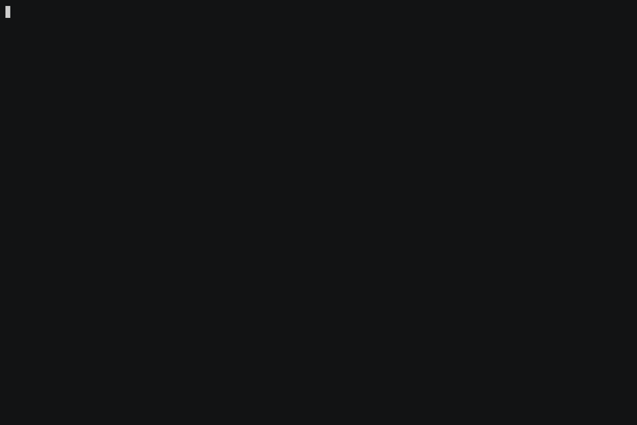

<div align="center">


**A security assessment harness for consultants: whitebox review and blackbox testing in one workspace, with coverage tracking that lists what an engagement has not yet tested.**

*Runs on local models, so client code can stay on the engagement machine. It ships no scanners; the agent drives the tools already installed.*

Three profiles, `review`, `recon` and `pentest`, packaged as a [pi](https://pi.dev) extension.

</div>

---

## See it run

A whitebox `review` of DVBank, the deliberately vulnerable banking app used in the benchmark below, run by a local 27B model. It opens on the engagement and the operator's brief, which sets the rule the session is held to: *anything not in the ledger does not count.*



The agent then greps for sinks and settles test cases while the panel counts surface, hypotheses and findings as they are recorded:


The ledger it leaves behind, with hypotheses browsable by class (including refuted ones) and a finding opened to its CWE, severity and target:


The panel counts the agent's own claims as it records them. How many of those claims hold up is measured by [the benchmark](#the-benchmark-result), not by the panel.

---

## Why pired

Consultants working under an NDA often may not send client source code to a hosted model API. Many engagements also cover both a code review and a test of the running system, delivered as one report. pired adds a security layer to the [pi coding agent](https://pi.dev) for that kind of work: an engagement workspace, a scope gate, a security-operator prompt, and two tools, `record` and `recall`. The agent runs the tools already on the machine (`nmap`, `ffuf`, `curl`, `sqlmap`, `semgrep`, …) through `bash`.

It is built around three things:

- **Local models.** The prompt is tuned for ~30B open-weight models, and the benchmark below used Qwen3.8 27B. With a local model, client code stays on the engagement machine. Hosted and subscription models also work where the engagement allows them.
- **Coverage tracking.** A checklist of weakness classes crossed with the recorded inventory (endpoints, parameters, hosts) gives a test plan in which each cell is one class asked of one element. A hypothesis records one test and its verdict, `recall gaps` lists the cells still untested, and a class that was checked and ruled out is recorded too, which a findings list cannot show. On the benchmark below the gain came from the security prompt; a separate experiment has so far found no added recall from the ledger.
- **One workspace for both halves of an engagement.** `review` covers whitebox work and `recon`/`pentest` cover blackbox work. All three write to the same engagement ledger, so findings, evidence and coverage from the code review and the live test end up in one place.

**What pired is not.** It is not a scanner: it has no detection engine of its own and does not produce rule-by-rule scanner output. It does not replace the assessor either: it drafts findings, and the operator verifies them and signs the report. It ships no tools; when one it needs is missing, the agent asks the operator for it. Its `core/` imports nothing from pi, so the security logic is unit-tested without pi or real I/O and is not tied to one agent host.

**Authorized use only.** `recon` and `pentest` act on live systems: point them only at systems you have written permission to test. The scope gate prevents accidents; it is not a containment boundary and not a substitute for that permission ([Security & authorized use](#security--authorized-use)).

---

## The benchmark result

The first benchmark is DVBank, the banking app in the demo above. It has an answer key of 53 CWE/OWASP-tagged vulnerabilities and a deterministic grader. Every arm got the same target, prompt and grader; only the harness and the model changed.

| | Recall | Precision | F1 | Critical recall | Cost/scan |
|---|:--:|:--:|:--:|:--:|:--:|
| **pired + Qwen3.8 27B** *(local)* | **0.74** <sub>[0.70, 0.79]</sub> | 0.65 | 0.69 | **100%** | ~$0.26 |
| codex CLI 0.147.0 + gpt-5.6-sol *(frontier)* | 0.68 | **0.80** | **0.74** | 93% | ~$0.19 |
| vanilla pi + Qwen3.8 27B *(no pired)* | 0.59 | 0.56 | 0.57 | 79% | ~$0.16 |

pired's row is the mean of 5 runs with a 95% interval, from a re-run ([`research/05`](./research/05-rerun-2026-08.md)) that reproduced the original single-run figures. The other two rows are single runs. Excluding frontend findings, which the key cannot score, pired's precision rises to 0.73 and its F1 to 0.74.

### What this establishes

**The security layer lifted the same model.** With pired, Qwen3.8 27B went from F1 0.57 to 0.69 and from 79% to 100% critical recall. Its recall (0.74) and critical recall were also above the single Codex run's (0.68 and 93%). The gains came where a generic prompt is weak: all four cryptographic-failure bugs (none without pired), plus business-logic and design flaws the bare model missed.

**Memorization does not explain it.** On a mutated copy of the app (renamed routes, shifted line numbers, changed literals) recall was identical, with 100% critical recall and none of the 6 decoys reported.

pired led on recall and critical recall, and Codex led on precision. Scored on backend findings only, pired's F1 (0.737) matches Codex's (0.735).

### What it does not establish

**That the ledger caused the gain.** The re-run also graded the ledger and found it almost unused: 0.8 records per run against 61 findings reported. The agent bypassed the ledger and still found the bugs, so the gain belongs to the prompt.

A single detection scan is also the task least likely to need state that lasts across sessions, so this benchmark did not test the ledger. A later experiment did, over three sessions with the ledger kept or wiped between them. Scored the same way, keeping the ledger added no recall, and the last session on a full ledger stopped in about half the time because the agent treated the work as done ([`research/06`](./research/06-compounding-2026-08.md)).

A later prompt revision (*explore-first + coverage floor*) scored 0.81 recall and 0.76 F1 in a single run ([`research/03 §5d`](./research/03-results.md)). It has not been replicated or checked against the mutated variant, so it is not in the table.

### Real CVEs

On real CVEs in real software (17 targets built from maintainers' security patches, each scanned at the commit before the fix), recall roughly halves:

| | teaching app *(DVBank)* | real CVEs *(corpus)* |
|---|:--:|:--:|
| **pired + Qwen3.8 27B** | 0.70–0.74 | **0.25–0.30** |
| codex + gpt-5.6-sol | 0.68 | 0.26 |

The teaching-app numbers therefore overstate real-world recall by about 2×, for both harnesses.

Run pired three times over the same targets and its result changes on half of them; run codex three times and it gives the same result on 5 of 6. Differences of a few points are inside pired's own run-to-run spread, so these numbers are not a ranking.

An agent with network access can also look up the answer. The targets are pre-patch commits, so the fixed release is effectively the answer key, and the run transcripts (not published) show up to 34 `pip download`, `git clone` and `diff -ru` attempts per target. Stripping `.git` and changelogs does not prevent that.

With the network blocked by pired's scope gate and targets restored from clean snapshots, pooled recall stayed at 0.250. Each of the two hits took about 1,000 seconds of analysis, against about 150 seconds for the runs that gave up. `jinja-1475` was found in full with the network blocked, a bug codex missed in all 3 runs. See [`research/07`](./research/07-corpus-2026-08.md).

Methodology, per-category results, token and cost accounting, and threats to validity are in [`research/`](./research/).

---

## Install

On a machine without pi or Node.js, one command installs everything:

```bash
# macOS and Linux
curl -fsSL https://raw.githubusercontent.com/mamgad/pired/main/install.sh | sh
```

```powershell
# Windows
powershell -c "irm https://raw.githubusercontent.com/mamgad/pired/main/install.ps1 | iex"
```

Both scripts check the machine, print what they will install and where, ask once, and then install it: Node.js if it is missing or older than 22.19, pi, pired, and the PATH entry for the `pired` command. **They do not register pired with pi.** `pi` stays the pi you already had, and the security layer loads only when you run `pired`, which passes it to pi with `-e` for that run (ADR-017). They do register two third-party packages with pi, each a separate row in the plan with its own opt-out: [pi-subagents](#sub-agents) and [pi-mcp-adapter](#mcp). On macOS and Linux, `--dry-run` prints the plan and stops, and `-y` skips the question; on Windows these are `PIRED_DRY_RUN=1` and `PIRED_YES=1`, because the documented `irm | iex` install cannot pass arguments.

**No root needed.** A fresh Ubuntu install has neither Node nor git, and the script needs `sudo` for neither: Node comes from nodejs.org as a checksum-verified tarball owned by your user under `~/.local/share/pired`, and a `github:` source is fetched over HTTPS when git is missing. The plan shows where it installs before it asks: `~/.local/share/pired` when it brings its own Node; otherwise npm's global prefix, or `~/.local` when that prefix is not writable (`NPM_PREFIX` overrides both). pired keeps engagements in `~/.pired`, and the plan's undo line removes both. `~/.pi` belongs to pi: the installer writes there only to register pi-subagents and pi-mcp-adapter, and the plan says how to remove each. It installs no daemon or service and adds no shell hooks beyond the one PATH line shown in the plan.

Windows gets its own script because npm lays out a global install differently there and PATH is a registry value, not a line in a dotfile. **No administrator rights are needed either.** The MSI from nodejs.org would need them, so the script uses the per-user `.zip` instead, checksum-verified against the same `SHASUMS256.txt`, unpacked under `%LOCALAPPDATA%\pired` and linked by a directory junction. None of that needs elevation, and neither does the `HKCU` PATH entry. The script does not install `bash`, which pi needs to run tools: Git for Windows is a ~250MB install with shell integration and file associations, so the script reports that it is missing and points you to `winget` or pi's own managed copy.

```bash
pired          # review the current directory
```

**If you already have pi,** pired installs as an ordinary pi package, with no npm global install and no launcher:

```bash
pi install git:github.com/mamgad/pired
pi                                       # the security layer is loaded
```

That registers it in `~/.pi/agent/settings.json`, and every later `pi` starts with the security layer. It brings no dependencies of its own (pi supplies the modules the extension imports), and `pi config` lists what it added (the extension and the `pired` theme) if you want to switch either off. `pi remove git:github.com/mamgad/pired` removes it.

### Which route

| | what it gives you | writes |
|---|---|---|
| `pi install <src>` | user-wide: every `pi` session loads the security layer | `~/.pi/agent/settings.json` |
| `pi install -l <src>` | this project only; commit `.pi/settings.json` and a teammate's first trusted `pi` installs it for them | `.pi/settings.json` |
| `pi -e <src>` | one session, from a temporary clone | nothing |
| `install.sh` / `install.ps1` | the `pired` and `pired-state` launchers on top of the package, plus Node.js itself when the machine has none; a bare `pi` is left untouched | npm global + PATH |

`<src>` is any pi package source: `git:github.com/mamgad/pired`, an npm spec, or a path to a checkout (`pi install ~/src/pired` is recorded as a path, not copied, so your edits are live on the next start).

The launcher is the only difference in behaviour. `pired` starts pi with the profile, thinking level, `--approve`, the `pired` theme and the target directory already set; with a package install you pass these yourself:

```bash
pired --profile pentest                                                 # launcher
pi --pired-profile pentest --thinking high --use-theme pired --approve   # bare pi
```

### From a clone

To read the installer before running it, or to install a branch you are working on, clone first. Each script installs the checkout it sits in:

```bash
git clone https://github.com/mamgad/pired.git && cd pired && ./install.sh
```

```powershell
git clone https://github.com/mamgad/pired.git; cd pired; .\install.ps1
```

<details>
<summary>Other ways to install</summary>

```bash
# npm global: the launchers, without the installer script
npm install -g --ignore-scripts github:mamgad/pired
pi install "$(npm root -g)/pired"        # optional: opt a bare `pi` in too

# project-local, for one engagement
pi install -l git:github.com/mamgad/pired

# one session, from a clone, installing nothing
pi -e ./extensions/pired.ts -e ./extensions/hosts.ts --pired-profile review
```

Both installers keep an existing pi at or above 0.86.1 and upgrade an older one; `PIRED_SKIP_PI=1` forces the skip, `PIRED_SOURCE` chooses what to install from, and `NPM_PREFIX` picks the prefix. They register pi-subagents and then pi-mcp-adapter with pi; `PIRED_SKIP_SUBAGENTS=1` and `PIRED_SKIP_MCP=1` decline each.

</details>

pired uses pi's frontend as it is (TUI, `/model` switching, `/login`, themes, sessions, autocomplete, MCP) and adds the security layer on top.

## Quickstart

**First, give it a model.** Start `pired` and run **`/provider`**, or pick *"Add a custom provider…"* from pi's own `/login`. It asks for the base URL and token of a server you already run (LM Studio, Ollama, llama.cpp, vLLM, or anything OpenAI-compatible), asks that server which models it serves, and adds them to `/model`. See [Models](./docs/models.md).

```bash
# review the code in the current project (read-only, no network gate)
pi -e ./extensions/pired.ts -e ./extensions/hosts.ts --pired-profile review -p "audit ./src for injection and auth bugs"
```

- **Profiles.** `--pired-profile review | recon | pentest` (default `review`).
  - `review`: read-only code audit, no network gate; works with no config.
  - `recon` / `pentest`: network testing, **blocked until** an authorized scope is present.
- **Scope.** Drop a `pired.scope.json` (loaded only when the project is trusted):

  ```json
  {
    "engagement": "acme-webapp",
    "authorized": true,
    "mode": "enforce",
    "targets": { "domains": ["*.acme.test"], "cidrs": ["10.10.20.0/24"] },
    "exclude": { "urls": ["https://app.acme.test/admin/"] }
  }
  ```

- **Findings.** `/findings` browses them and `/report` exports a Markdown report; engagement state lives in `~/.pired/engagements/<name>/` (see [`FORMAT.md`](./FORMAT.md)).

- **The report includes coverage.** The exported Markdown ends with what was tested as well as what was found: test cases settled, the hypotheses that ruled a class out against specific surface, and the classes and surface nobody reached, listed by name. Targets appear as `POST /api/split-bill` rather than as inventory ids.

- **Report-grade findings.** A finding carries what the flaw is, what it costs the client in their terms, and the concrete fix; `record` says which of the three is still missing, and the exported report marks an unwritten section instead of leaving it out. CVSS vectors are validated against the version they claim (v4.0 by default, v3.1 when an engagement requires it), so a v3.1 vector cannot enter the ledger under a v4.0 label. `recall finding id=<id>` reads one back in full, which is what a rewrite pass works from, either inline or in a `pired-investigate` worker (see `skills/ops-technical-writer`).

- **Correcting the ledger.** Tell the agent a finding is not real, that the client has accepted the risk, or to set it aside, and it records the decision as a status with your reason; the finding keeps its place in the report and leaves the open count. A row that should never have been recorded can be retired. Nothing is erased: the ledger is append-only, so every version stays in the file above the tombstone. `/dedupe` merges duplicates an older engagement already accumulated into one row each, moving every reference onto the surviving id so no coverage is lost. It shows what it would do and writes only when you confirm.

## The interface

pired reads coverage from the ledger on disk and shows it in a side panel by default, so you do not have to ask the model for `recall gaps` to see it:

```
╭─ ⦿ acme-webapp ──────────────────────────────────────╮
│  pentest · web application                           │
│                                                      │
├─ needs you ──────────────────────────────────────────┤
│  ! Test the password-reset flow against live email?  │
│                                                      │
├─ coverage ───────────────────────────────────────────┤
│  ███████████████░░░░░░░░░ 62%                        │
│  105 of 170 cases · 65 gaps                          │
│  ▲ 7  ● 98  ◐ 3  ⊘ 2                                 │
│                                                      │
├─ scope ──────────────────────────────────────────────┤
│  ● authorized · gate enforce                         │
│  domains 1 · cidrs 1                                 │
│                                                      │
├─ findings ───────────────────────────────────────────┤
│  ! 1 confirmed, not written up                       │
│  ⬤ crit 1  ⬤ high 2  ⬤ med 3                         │
│  ▸ SQLi in /api/transfer amount                      │
│                                                      │
│                                  F7 expand · F6 hide │
╰──────────────────────────────────────────────────────╯
```

`/panel` or `F6` toggles it; `F7` or `/maximize` expands it for reading and scrolling. Use F6/F7 in Windows Terminal or PowerShell to avoid Alt+P model-binding conflicts. The Alt shortcuts still work where the terminal supports them, and macOS hints show the command fallbacks. `pired --no-panel` starts without it.

The coverage section counts **cells** and the hypotheses section counts **claims**. `record` applies one piece of reasoning to every target it covers, so the two are different numbers over the same ledger. The `!` line counts confirmed claims that no finding has been written for yet, because confirming settles a cell and only a finding reaches the client.

Alongside it: a status line with findings by severity, coverage and whether the scope gate is armed; `/coverage` for the full checklist × surface matrix; and notifications for new questions that do not interrupt an active form. `/blockers` lists every parked question, waiting ones first, with explicit answer and dismiss actions. Pressing Escape on an approval leaves it unanswered.

The panel also renders outside the TUI: `pired-state --watch` for a tmux pane, `--json` for your own status bar. Full tour: [docs/ui.md](./docs/ui.md).

## Documentation

[docs/](./docs/): [quickstart](./docs/quickstart.md) · [the interface](./docs/ui.md) · [the panel](./docs/panel.md) · [coverage](./docs/coverage.md) · [scope](./docs/scope.md) · [profiles](./docs/profiles.md) · [tools](./docs/tools.md) · [workspace](./docs/workspace.md) · [skills](./docs/skills.md) · [models](./docs/models.md) · [theme](./docs/theme.md) · [commands](./docs/commands.md) · [architecture](./docs/architecture.md) · [testing](./docs/testing.md) · [evaluation](./docs/evaluation.md)

## Models

pi handles model selection: use **`/model`** (or Ctrl+P). pired adds any custom OpenAI-compatible providers from `~/.pired/models.json` (LM Studio, Ollama, llama.cpp, OpenRouter, proxies) to that picker, alongside your built-in and subscription models.

To add one, pired puts **"Add a custom provider…"** in pi's own **`/login`** list, and **`/provider`** opens the same wizard. It asks for the base URL and token, asks the host which models it serves, works out the context window and the reasoning format, writes `~/.pired/models.json` with mode `0600`, and registers the host without a restart. A token given as `$ENV_VAR` is stored as that reference, not as the key.

```json
{ "providers": [ { "id": "openrouter", "baseUrl": "https://openrouter.ai/api/v1", "apiKey": "$OPENROUTER_KEY",
  "models": [ { "id": "qwen/qwen3.8-27b", "contextWindow": 265000, "reasoning": true } ] } ] }
```

---

## How it works

pired keeps an engagement's state on disk, in the workspace, rather than relying on the model's memory:

```
checklist × inventory = coverage → hypotheses → findings
                                     + loot / notes / evidence / artifacts / blockers
```

- **`record`** writes hypotheses, findings, inventory, loot, and blockers to an append-only, versioned JSONL workspace.
- **`recall`** queries it (`recall next`, `recall gaps`) so the agent keeps testing while coverage gaps remain. Whether that improves results has been measured separately, and so far it has not added recall; see [what the benchmark does not establish](#what-it-does-not-establish).
- The **scope gate** keeps `bash` and tool calls on authorized targets. It is focus and accident prevention, not a sandbox: a determined bypass (shell tricks, encoding) defeats it, and the real boundary is the container and network. Run pired inside a VM or container scoped to the engagement.

## Architecture

`core/` has no pi imports and is unit-tested with fake ports; a thin adapter connects it to pi, so the security logic does not depend on the host.

```
core/          security engine: no host imports, test-first (1,530 tests)
  ontology · workspace · scope · redaction · coverage · tools · prompts · stats
  export · panel · coverage-panel · statusline   (renderers are pure too)
extensions/
  pired.ts     the pi extension (tools, scope gate, prompt, UI, commands, providers)
  lib/         node host services · core->pi tool bridge · provider registration
bin/           pired (launcher) · pired-state (the panel, outside the TUI) · pired-ledger (record/recall from outside pi)
skills/  checklists/   opt-in methodology (web, api, network, code-review, firmware)
themes/        the pired theme
docs/          the documentation
eval/          assay, the harness's own test instrument
research/      the benchmark: methodology, results, data
FORMAT.md  PLAN.md
```

## Sub-agents

pired delegates through [**pi-subagents**](https://github.com/nicobailon/pi-subagents) when it is installed; without it, pired does not delegate. The supported stack is `pi-subagents ≥ 0.71.0` on `pi ≥ 0.86.1`, which is what the installers enforce and what was measured. An older pi-subagents, such as 0.66, still registers the workers, but it sends the full `subagent` tool schema with every request, while 0.71's lazy loader keeps the parent's standing cost small. At session start pired registers four security-operator agents: **`pired-scout`** (attack-surface mapping), **`pired-investigate`** (deep dive on one lead), **`pired-verify`** (adversarial refutation) and **`pired-escalate`** (impact amplification). On an engagement that opts in by setting `maxAgents` in its scope file, or for one run with `pired --agents 8` or `/agents 8` in the TUI, it lets the model use them without forcing it to. **Delegation is off by default:** in v5's pre-registered trial it found about as many true positives as the single agent at a higher cost and lower precision ([ADR-029](docs/decisions.md)). In v6 it helped slightly on GLM-5.3 Flash, but on GPT-6 Luna the delegating session stopped after a median 20 minutes and found fewer bugs ([ADR-039](docs/decisions.md)).

A child is an in-process foreground pi session that loads pired's own `record`/`recall` bound to the parent's workspace and arms the engagement scope gate: its records are durable immediately, and the parent reads them back with `recall`. Children start fresh, share no conversation history, run one at a time, have per-role turn and time budgets, and return a short handoff. The parent gate refuses any agent that is not one of the four, so external runners (claude-code, codex-exec, …) cannot be launched. See [Delegation](docs/delegation.md) and [ADR-027](docs/decisions.md).

`recall query=context refs=["src/routes.ts"]` retrieves the relevant shared model, surface, claims and blockers after delegation or compaction. A worker's durable output is what it records in the ledger and saves under `evidence/`. pi-subagents keeps the worker's transcript and run artifacts under pi's own session directory (`~/.pi/agent/sessions/…`, or the OS temp directory), not in the owner-only engagement workspace.

The installers register the package with pi and require a compatible version; `PIRED_SKIP_SUBAGENTS=1` declines it (delegation is then unavailable). To install it separately:

```bash
pi install npm:pi-subagents
```

Unlike pired itself, this package *is* registered with pi, so it loads in every `pi` run rather than only in `pired`. See [ADR-021](docs/decisions.md).

## MCP

[**pi-mcp-adapter**](https://github.com/nicobailon/pi-mcp-adapter) gives pi's model the MCP servers you configure, through one proxy tool. The installers register it with pi after pi-subagents, and update a registered `npm:pi-mcp-adapter` older than **2.33.0**. That floor comes from the scope gate: pired checks every MCP call against the engagement scope through the adapter's approval broker, and before 2.33.0 the adapter did not send the broker a call it had cached as approved for the session, so one session grant let later calls past the check. A version pinned below the floor, or a fork, is left alone, and the installer says what the scope check needs from it. `PIRED_SKIP_MCP=1` declines it. To install it separately:

```bash
pi install npm:pi-mcp-adapter
```

Like pi-subagents, it is registered with pi, so it loads in every `pi` run rather than only in `pired`.

---

## Development

Tests use vitest and fake ports (in-memory `Fs`, controllable `Clock`, deterministic `Ids`), so the core runs under test with no real I/O.

```bash
npm run check      # tsc --noEmit && vitest run && assay   (3,131 tests, 102 probes)
npm run assay      # the harness's own probes; see docs/evaluation.md
```

## Security & authorized use

pired is for **authorized** security work only. The scope gate is focus and accident prevention, not a containment boundary. Run pired inside a container or VM scoped to the engagement, and only against systems you are authorized to test.

To report a vulnerability in pired itself, see [SECURITY.md](SECURITY.md).

## License

MIT. See [LICENSE](LICENSE).

pired is an independent project. It is not affiliated with or endorsed by the pi project or by any vendor, model provider or open-source project named in the research.
